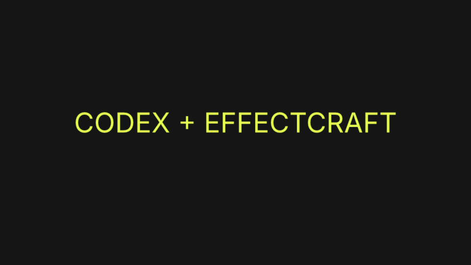

# EffectCraft ↔ Codex Bridge

Пишите задачу Codex обычным языком: он сможет создавать композиции и слои, анимировать свойства, применять эффекты, выполнять сценарии, смотреть кадры и сохранять результат в **EffectCraft 0.13.0**.

Проект предоставляет два входа:

- **MCP для Codex** — запускает официальный `effectcraft-cli mcp`, сохраняя нативные инструменты, схемы и ответы. В live-режиме работает с окном программы через control channel.
- **Локальный HTTP API** — предоставляет аутентифицированный доступ к тому же редактору для Python-скриптов и других локальных клиентов.

Текст задачи понимает модель Codex. Отдельной HTTP-конечной точки `/prompt` нет; MCP не зависит от HTTP API.



[Исходники интеграции](https://github.com/stella88-8bit/effectcraft-codex-bridge) · [Официальный EffectCraft](https://github.com/storytold/effectcraft) · [Релиз v0.13.0](https://github.com/storytold/effectcraft/releases/tag/v0.13.0)

## Быстрый старт на macOS

Нужны Python **3.10+**, установленное приложение **EffectCraft 0.13.0** и команда `codex` в `PATH`. На macOS официальный CLI поставляется отдельным архивом, внутри `.app` его нет.

1. Скачайте/клонируйте этот репозиторий в постоянную папку. После регистрации MCP не перемещайте её без повторной регистрации.
2. Откройте [Connect Codex.command](Connect%20Codex.command). Он скачает закреплённый официальный macOS universal CLI, если его нет, проверит SHA-256 и зарегистрирует сервер `effectcraft-codex` через `codex mcp add`.
3. **Перезапустите сервер `effectcraft-codex` в настройках MCP Codex или откройте новый чат**, затем проверьте появление инструментов EffectCraft. Запись конфигурации не загружает инструменты автоматически в уже идущий ответ.

Те же действия из терминала, находясь в папке репозитория:

```sh
python3 scripts/fetch_cli.py
python3 bridge.py doctor
python3 bridge.py install-codex
```

Если CLI уже установлен, пропустите скачивание и укажите его через `EFFECTCRAFT_CLI` или `--cli`. `doctor` проверяет пути, версию и доступность control channel; до запуска управляемой сессии поле `live_error` может сообщать, что приложение ещё не подключено.

Live — режим по умолчанию. Обёртка подключается к EffectCraft на `127.0.0.1:9877`. Если подходящая сессия не запущена, она открывает отдельный управляемый экземпляр с изолированными настройками. Уже открытое окно без `--control` от этого не становится управляемым. Перед переносом работы сохраните её; обёртка не закрывает пользовательскую сессию и не заменяет её документ при запуске. Для подключения только к уже работающему control channel используйте `--no-launch`.

После подключения напишите Codex, например:

> Прочитай состояние EffectCraft. Добавь в текущий проект отдельную композицию «Intro», 1920×1080, 30 fps, 5 секунд. Сделай тёмный фон, крупный титр «ПОЕХАЛИ» и плавное появление с Easy Ease. Покажи кадры на 0,5, 1,5 и 4 секундах, проверь, что текст не обрезан. Затем сохрани копию проекта и превью в новую папку. Текущий документ не очищай.

## HTTP API

Откройте [Start API.command](Start%20API.command) или запустите:

```sh
python3 bridge.py api --api-port 8767 --port 9877
```

API слушает только `http://127.0.0.1:8767`. Все маршруты требуют Bearer token, который сервер создаёт в `.state/api-token` с правами `0600`. Токен не выводится в журнал. Пример клиента читает его из файла, поэтому копировать секрет в терминал не нужно:

```sh
python3 examples/api_client.py --token-file .state/api-token health
python3 examples/api_client.py --token-file .state/api-token commands --filter comp.new
python3 examples/api_client.py --token-file .state/api-token command comp.new --params '{"name":"API Intro","width":1280,"height":720,"frameRate":30,"duration":4}'
python3 examples/api_client.py --token-file .state/api-token command layer.newText --params '{"text":"CODEX + EFFECTCRAFT","size":68,"fill":"#e0ff38"}'
python3 examples/api_client.py --token-file .state/api-token render --comp "API Intro" --time 1.5 --max-side 1280 --out intro.png
```

Команды создания изменяют текущий проект. Для надёжной автоматизации используйте возвращённые id объектов. Пример клиента не перезаписывает существующий PNG. Если изменили `--state-dir` или `--api-port` сервера, передайте соответствующие параметры клиенту.

| Метод и путь | Назначение |
| --- | --- |
| `GET /health` | Проверка API и реального состояния редактора |
| `GET /v1/state` | `editor.state` |
| `GET /v1/commands?filter=...` | Поиск команд с их схемами |
| `GET /v1/ui` | Нативный `ui.inspect` |
| `GET /v1/openapi.json` | OpenAPI 3.1 внутри поля `result` |
| `POST /v1/command` | Команда движка: `{"command":"comp.new","params":{}}` |
| `POST /v1/rpc` | Метод control protocol: `{"method":"ui.inspect","params":{}}` |
| `POST /v1/render-frame` | PNG base64: `{"comp":1,"time":1.5,"max_side":1280}` |

Ответы имеют форму `{"ok":true,"result":...}` либо `{"ok":false,"error":{"code":...,"message":...,"outcome_unknown":...}}`. Вложенные результаты сценариев и пакетов тоже нужно проверять: доставка команды ещё не означает успешного выполнения каждого шага.

## Headless и демонстрация

Headless включается **явно**, работает в отдельном движке без окна и не редактирует видимый проект пользователя. Обёртка включает нативные autosave checkpoints; результаты всё равно следует явно сохранять в выбранное место.

```sh
python3 bridge.py mcp --headless
python3 bridge.py mcp --headless --project /absolute/path/to/project.ecproj
```

Это MCP-сервер через stdio: обычно его запускает MCP-клиент. Образцы конфигурации находятся в [examples/mcp-config.example.toml](examples/mcp-config.example.toml). При потере live-подключения автоматического перехода в headless нет.

Готовая live-демонстрация добавляет отдельную композицию, сохраняет PNG и копию проекта в новую папку:

```sh
python3 bridge.py demo --out demo-output
```

Подробные примеры, включая сценарий [demo.jsx](examples/demo.jsx), — в [docs/examples.md](docs/examples.md).

## Полномочия и ошибки

API рассчитан на доверенные локальные процессы: он запрещает браузерный `Origin`, проверяет `Host`, ограничивает тело запроса и не обслуживает произвольные файлы. При этом владелец токена обладает полномочиями EffectCraft, включая файловые операции и scripting. Это **не файловая песочница**. Нативный control port не имеет аутентификации; HTTP-токен не закрывает прямое обращение локальных процессов к нему.

После ошибки с `outcome_unknown:true` сначала осмотрите проект: команда могла уже исполниться. HTTP-обёртка не повторяет запрос автоматически. Не публикуйте API через туннель или reverse proxy. Ограничения файлов нативного MCP и их компромиссы описаны в [docs/security.md](docs/security.md).

## Проверки

Runtime использует только стандартную библиотеку Python. Обычные тесты не требуют установленного EffectCraft:

```sh
python3 -m unittest discover -s tests -v
python3 -m compileall -q effectcraft_codex bridge.py examples
```

Локально 71 тест пройден на Python 3.12.14 и 3.15.0. CI настроен для Python 3.10–3.13; сам файл CI не является подтверждением запуска GitHub Actions. Реальное подключение, создание композиции и получение PNG через API и native MCP проверены на macOS с EffectCraft 0.13.0. Другие операционные системы пока не проверялись.

Для собственной проверки живого приложения запустите API, затем вызовите `python3 scripts/live_smoke.py --out smoke-output`. Этот opt-in тест добавляет композицию в подключённый проект и сохраняет отдельную копию; обычный unit test suite его не запускает.

## Версия и первоисточники

Интеграция закреплена на **EffectCraft v0.13.0**, commit `de3fec28ed7a3d7a700a9d8ea307779dcda99a8e`. Совместимость с другой версией требует проверки схем и реального рендера.

- [Официальные инструменты для агентов](https://github.com/storytold/effectcraft/blob/de3fec28ed7a3d7a700a9d8ea307779dcda99a8e/docs/agents.md)
- [Официальный MCP: ресурсы, confinement, прогресс и отмена](https://github.com/storytold/effectcraft/blob/de3fec28ed7a3d7a700a9d8ea307779dcda99a8e/docs/mcp.md)
- [Официальный control protocol](https://github.com/storytold/effectcraft/blob/de3fec28ed7a3d7a700a9d8ea307779dcda99a8e/docs/control-protocol.md)
- [Архитектура этой интеграции](docs/architecture.md)

Код интеграции распространяется под [MIT](LICENSE). EffectCraft — отдельный upstream-проект со своими лицензиями; его бинарники не входят в исходный репозиторий. `.state`, `.runtime` и локальные секреты исключены из Git. Изображение выше — реальный кадр демонстрационной композиции, полученный через интеграцию.
